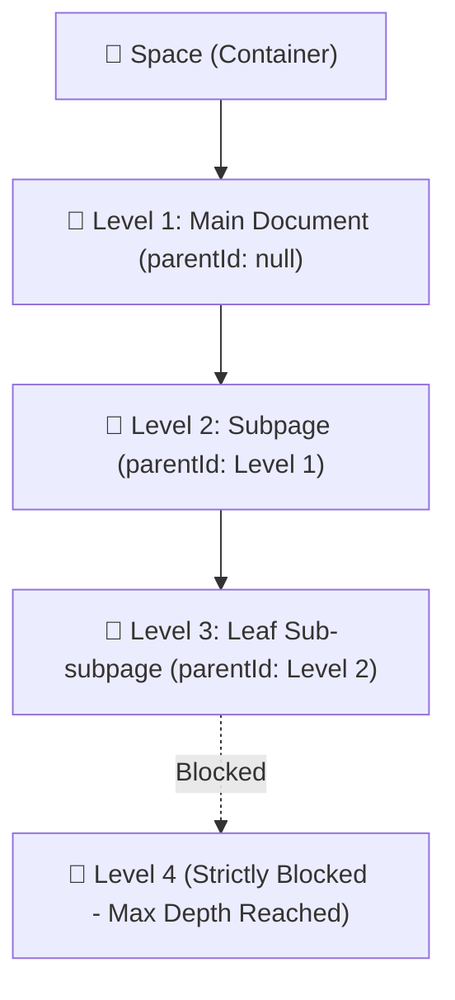

> 💡 Doction enforces a **Strict 3-Level Nesting Architecture**: `Space → Level 1 Page → Level 2 Subpage → Level 3 Sub-subpage`. This golden ratio prevents chaotic "infinite depth mazes" while providing structured depth.

---

## 1. The 3-Level Hierarchy Architecture

| Hierarchy Level | Role | Allowed Subpage Creation |
|---|---|---|
| **Space** | Root Workspace Folder | Can create Level 1 Pages |
| **Level 1** | Main Document (`parentId: null`) | ✅ Can create Level 2 Subpages |
| **Level 2** | Nested Subpage (`parentId: L1`) | ✅ Can create Level 3 Sub-subpages |
| **Level 3** | Deep Leaf Document (`parentId: L2`) | 🛑 **Maximum Depth Reached!** Cannot create further subpages. |

---

## 2. Why Enforce a 3-Level Limit?

In tools with unbounded infinite nesting (like Notion), users often bury critical documents 7 or 8 levels deep. Finding those notes later requires digging through endless folders, and the sidebar becomes cramped and unreadable.

Research across enterprise documentation platforms (GitBook, Confluence, Stripe Docs) proves that **3 levels represents the optimal balance**:
- **Broad Overview:** Handled by Spaces and Level 1 documents.
- **Deep Modules:** Handled by Level 2 subpages.
- **Specific Technical Details:** Handled by Level 3 sub-subpages.

---

## 3. Three Ways to Create Subpages

You can add a subpage from three convenient locations:

1. **From the Sidebar Tree:** Hover over any Level 1 or Level 2 page row in the sidebar and click the `+` button on the right.
2. **From the Page Actions Menu:** Click the `•••` (More options) button in the top right corner of any page and select **"Add subpage"**.
3. **From the Bottom Subpages Grid:** Scroll to the bottom of any parent document and click **"+ Add subpage"** in the Subpages section header.

> 🔒 **Depth Guard:** On Level 3 documents, the `+` button is automatically hidden, and the creation modal prevents adding Level 4 children.

---

## 4. Interactive Sidebar Tree Features

The sidebar displays your pages in a clean, hierarchical tree:
- **Branch Connector Lines:** Subpages are connected to their parent with clean geometric CSS branch lines (`border-l` with branch arms).
- **Expand & Collapse Chevrons:** Pages with subpages show an animated chevron (`>`) that rotates 90 degrees when opened.
- **Uniform Title Alignment:** Pages without children include a 16px alignment spacer so all document icons and titles stay perfectly straight.
- **LocalStorage Persistence:** Open pages are saved in browser storage (`doction:expanded_pages`), so your custom tree structure stays open across browser refreshes.
- **Auto-Unfold on Navigation:** Whenever you open a deep subpage (via Search `⌘K` or direct URL), the sidebar automatically unfolds its Space and all ancestor pages down to the target document.

---

## 5. Dynamic Ancestor Breadcrumbs

At the top of every document, Doction renders the full ancestor trail:

$$\text{Space} \longrightarrow \text{Level 1 Document} \longrightarrow \text{Level 2 Subpage} \longrightarrow \text{Current Page}$$

- Every ancestor in the breadcrumb is an **interactive clickable link** with its icon and title.
- Long page titles are gracefully truncated with tooltips to prevent overflow on mobile and compact screens.

---

## 6. Subpages Card Grid in Documents

When a page contains child subpages, Doction displays a dedicated **Subpages Grid** right above the footer:
- Displays each child subpage's emoji icon, title, and relative update timestamp.
- Shows lock indicators for read-only or restricted subpages.
- Clicking any card instantly navigates to that subpage.

---

## 7. 400+ Categorized Emoji & Icon Picker 🎨

Give every document and space its own unique visual identity:
- **Instant Icon Picker Modal:** Click on any page icon or space icon to open the full-screen modal picker.
- **8 Organized Categories:** Rapidly browse over 400+ modern Unicode emojis grouped into:
  - 😀 Smileys & Expressions
  - ✋ Gestures & People
  - 🌿 Nature & Plants
  - 🍕 Food & Drinks
  - 🚀 Travel & Places
  - 💻 Tech & Objects
  - 🔣 Symbols & Signs
  - 🚩 Flags & Milestones
- **Real-Time Search:** Type any keyword (like `"rocket"`, `"chart"`, `"lock"`, `"book"`) in the search bar for instant filtering.
- **Portaled Rendering:** The picker renders at the application root level with clean backdrop blur, ensuring it never clips beneath sidebars or headers.
