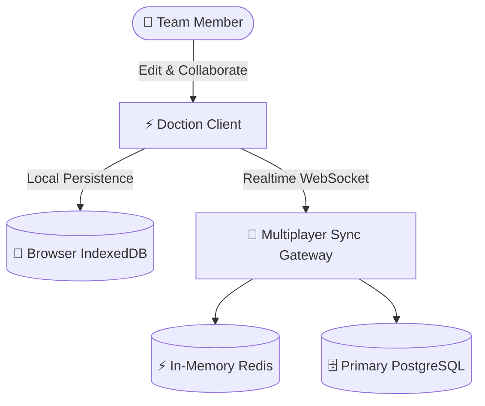
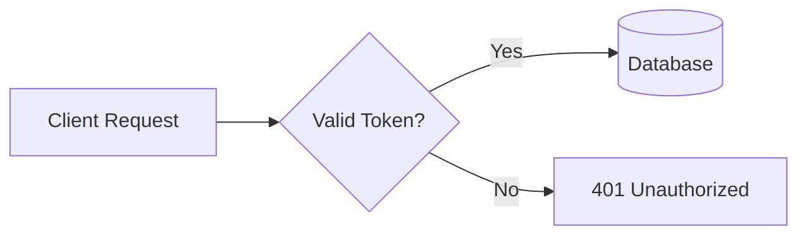
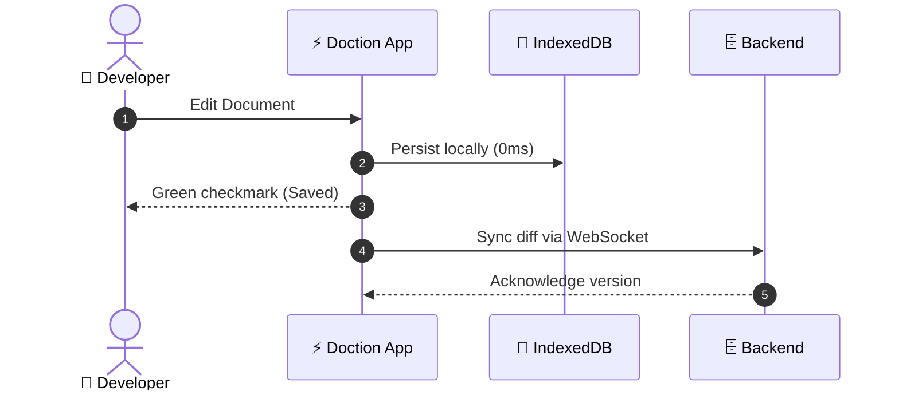
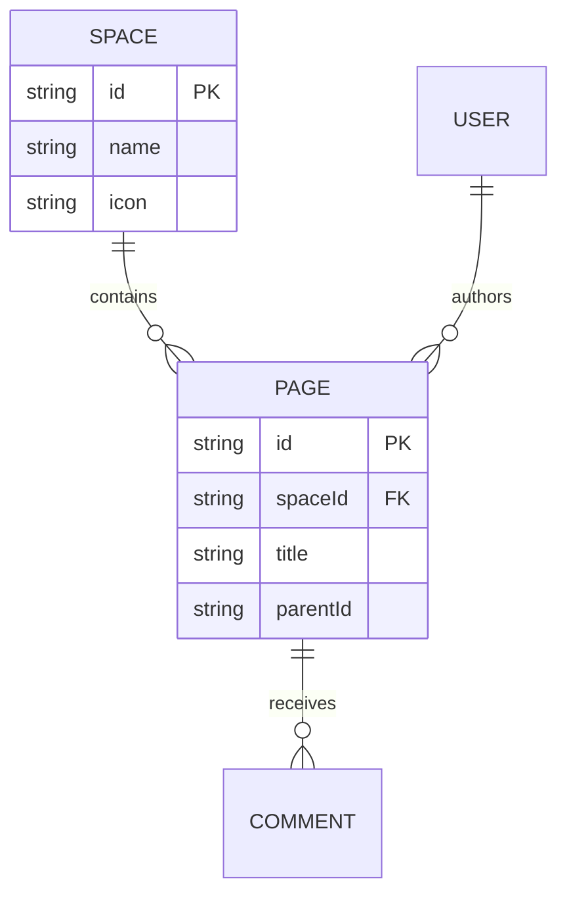

> 💡 Doction features first-class native support for **Mermaid.js** — the industry standard text-to-diagram engine that lets you render system architecture, sequence flows, database schemas, and git trees directly from Markdown code.

Type `/mermaid` on any empty line to insert a diagram block into your document.

---

## 1. Why Mermaid in Doction?

Mermaid treats diagrams as **Code-as-Documentation**:

| Benefit | How It Works in Doction |
|---|---|
| **Zero Vendor Lock-In** | Diagrams are stored as plain text. You can copy/paste them into GitHub, GitLab, Notion, or Obsidian. |
| **Zero Bloat Code Splitting** | Mermaid's ~620 KB engine is dynamically loaded only when a diagram page is opened. 0 KB overhead when dormant. |
| **Instant Dark / Light Theming** | Diagrams automatically adapt their stroke colors, fonts, and node fills to Doction's active theme. |
| **Vector SVG Export** | 1-Click buttons to **Copy SVG** markup or **Download SVG** for Figma, pitch decks, and presentations. |

---

## 2. Supported Diagram Types

### A. Flowcharts (`flowchart TD` / `flowchart LR`)
Flowcharts are ideal for architecture blueprints, business logic, and algorithm branching:

### B. Sequence Diagrams (`sequenceDiagram`)
Sequence diagrams model step-by-step communication between multiple services over time:

### C. Entity Relationship Diagrams (`erDiagram`)
ER diagrams visualize database schemas, fields, and relationships:

---

## 3. Theme Adaptation & Dark Mode

In Doction, Mermaid diagrams are fully theme-aware:
- When you toggle between **Light Mode** and **Dark Mode** (`Sun`/`Moon` icon or system preference), Mermaid SVG nodes automatically re-render with matching background colors, border strokes, and typography.
